<div align="center">

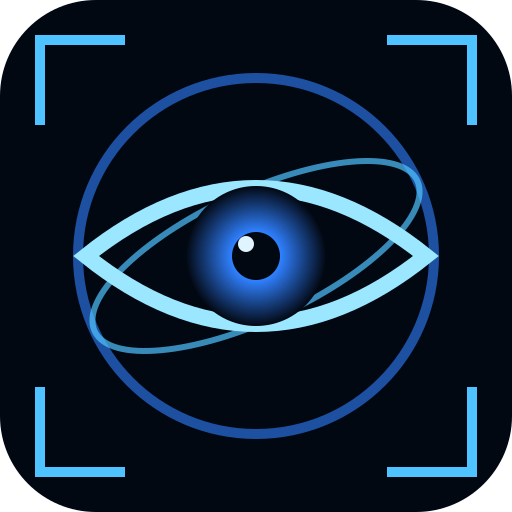

# A R G U S

**Orbital surveillance console: a real-data "spy satellite" globe in your browser.**

Satellites, flights, military aircraft, ships, trains, weather radar, live IR clouds, earthquakes, wildfires, disaster alerts, undersea cables, military sites, internet outages, radio, live traffic cameras, all on one 3D globe.

[](https://distorbed678.github.io/argus/)


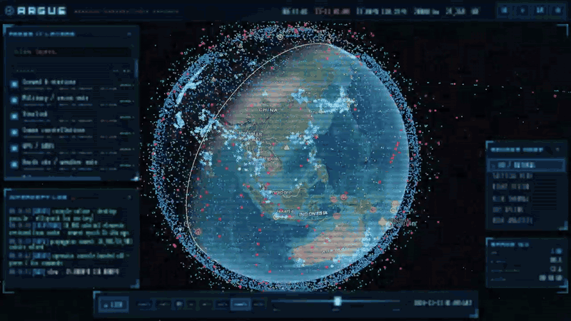

<sub>~17,000 real satellites propagated with SGP4 in a Web Worker, shown here at 10 minutes per second</sub>

</div>

---

## ◉ What it does

ARGUS is a Google-Earth-style 3D globe dressed as a sci-fi intelligence console. **Everything on screen is real, public, live data.** There are no mock-ups and no simulated contacts. Every layer shows its source, freshness and status (`LIVE`, `CACHED`, `OFFLINE`, `KEY REQ`, `NEEDS PROXY`).

<table>
<tr>
<td width="50%">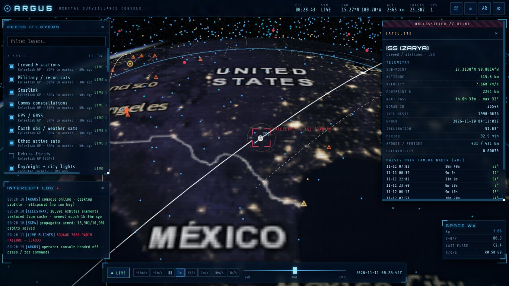</td>
<td width="50%">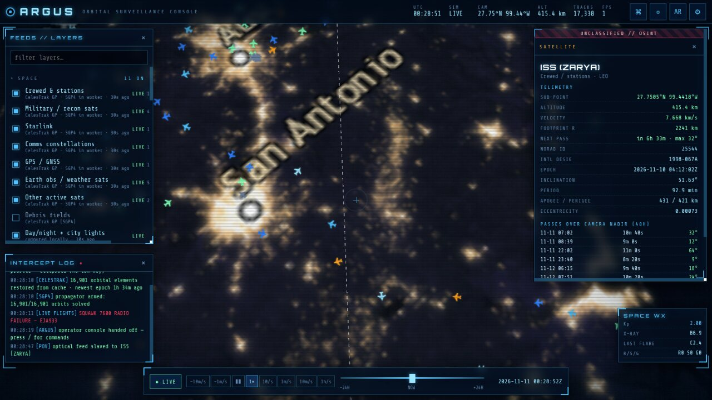</td>
</tr>
<tr>
<td><b>Target lock:</b> click any satellite for a classified-style dossier with live altitude, velocity, footprint, orbit ring, ground track and pass predictions.</td>
<td><b>Satellite POV:</b> ride along with the ISS (or any of 17k objects) looking down at the night side's city lights.</td>
</tr>
<tr>
<td>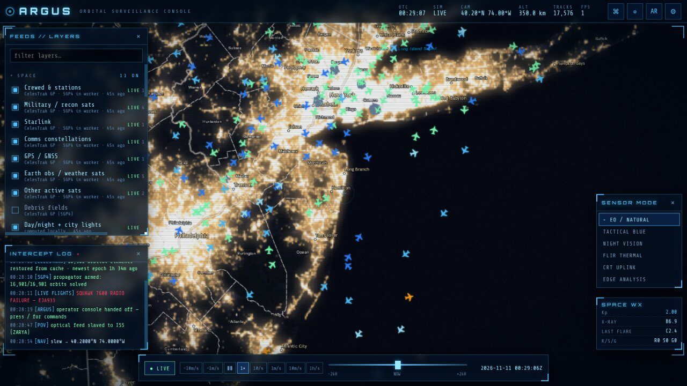</td>
<td>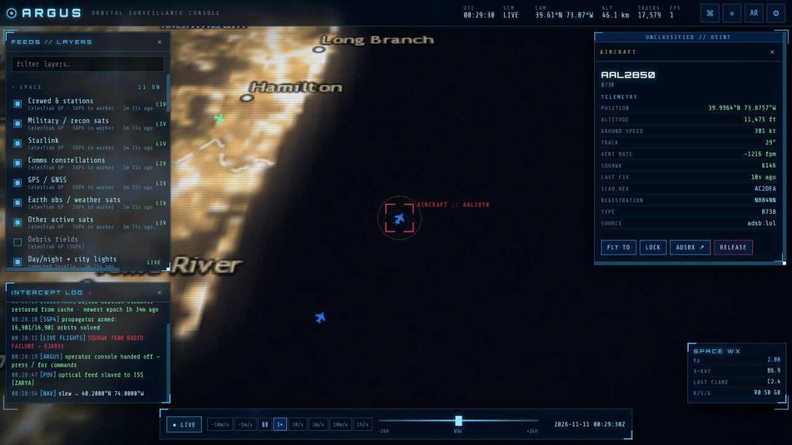</td>
</tr>
<tr>
<td><b>Live air traffic:</b> hundreds of ADS-B targets around the view, colour-coded by altitude, dead-reckoned between polls.</td>
<td><b>Aircraft dossier:</b> callsign, registration, type, altitude, speed, squawk, with alerts for 7500 / 7600 / 7700 emergencies.</td>
</tr>
<tr>
<td>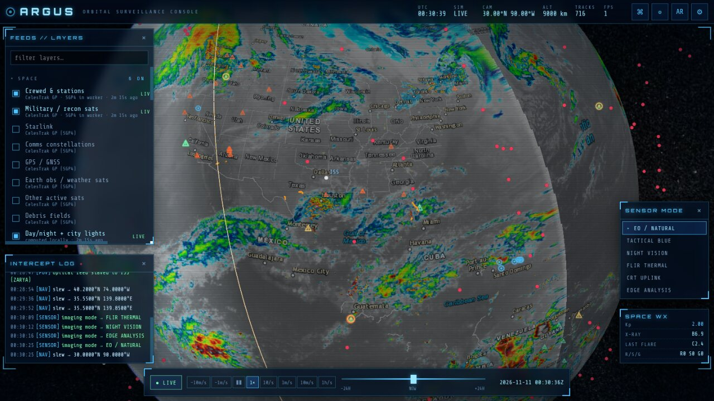</td>
<td>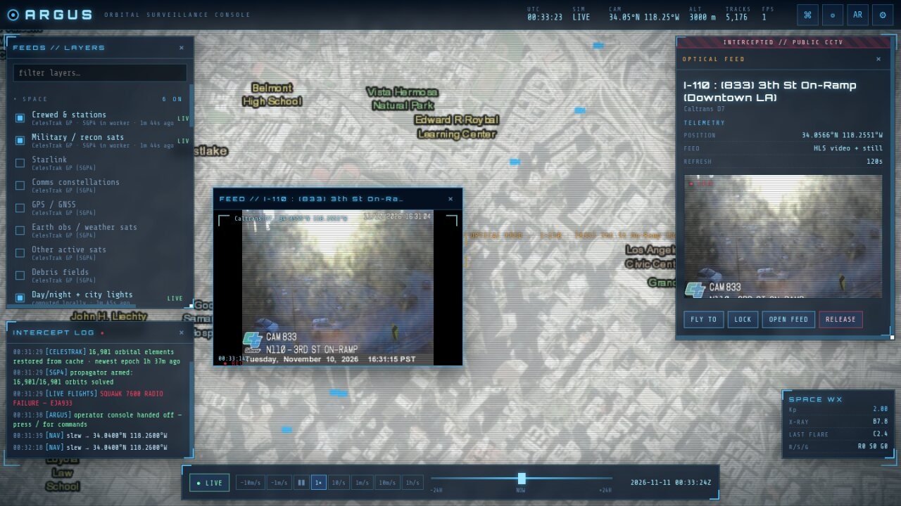</td>
</tr>
<tr>
<td><b>Weather intel:</b> 10-minute geostationary IR clouds (GOES-E/W + Himawari), animated rain radar, disaster alerts.</td>
<td><b>Intercepted feeds:</b> 4,400+ public traffic cameras open in draggable CCTV windows.</td>
</tr>
</table>

### Sensor modes

Real-time GLSL post-processing turns the globe into different "sensors":

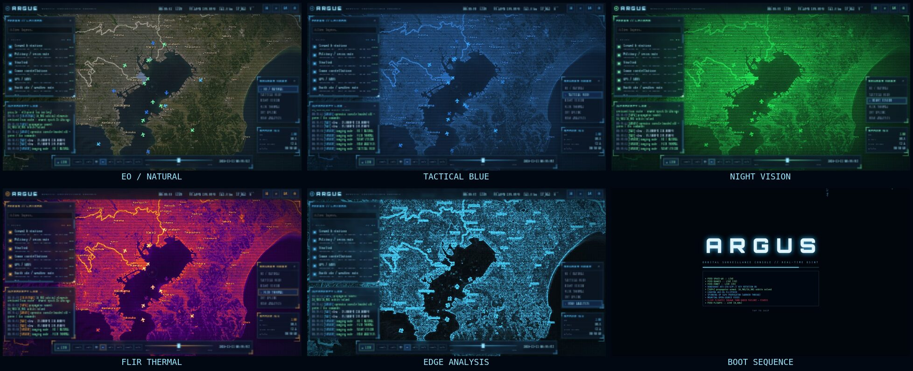

### Command line

Press <kbd>/</kbd> anywhere:

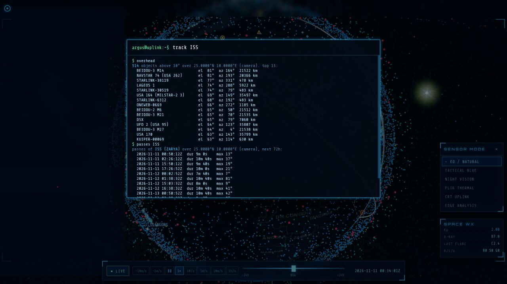

```text
track ISS            lock the camera on a target (satellite, callsign, hex, NORAD id…)
goto Tokyo           geocode and fly anywhere (or: goto 38.9,-77.03 50)
pov 25544            ride along with a satellite
overhead             everything above your horizon right now
passes ISS           next 72 h of passes over your GPS position
layer fires on       toggle any feed
mode flir            switch sensor mode
time +6h · rate 600 · live
```

### Mobile

Bottom-sheet panels, big touch targets, installable as a full-screen PWA, and an **AR sky view** that overlays the satellites above you on your phone camera using the compass and gyroscope.

<div align="center">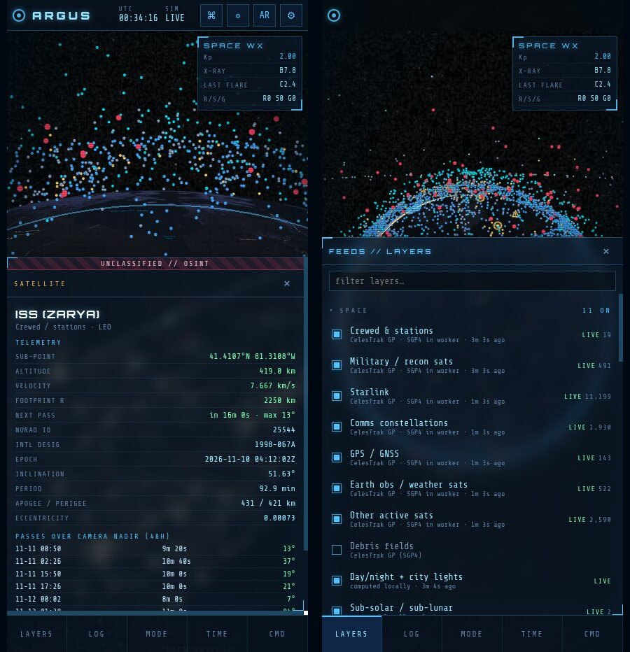</div>

---

## ◉ Data feeds

<details open>
<summary><b>40+ layers in 8 categories</b> (all keyless unless marked)</summary>

| Category | Layers | Source |
|---|---|---|
| **Space** | ~17,000 active satellites in 7 categories (stations, Starlink, comms, GNSS, Earth-obs, **military/recon**, other) + debris fields | CelesTrak GP → SGP4 in a Web Worker |
| | Day/night terminator + city lights, sub-solar/lunar points | computed locally + NASA Black Marble |
| | Aurora oval · Kp index · X-ray flares · NOAA R/S/G scales | NOAA SWPC |
| | Upcoming rocket launches with live countdown | The Space Devs Launch Library 2 |
| **Air** | Live flights (regional zoomed in, global zoomed out) | adsb.lol → adsb.fi → airplanes.live · OpenSky ¹ |
| | Military aircraft worldwide | adsb.lol `/v2/mil` ¹ |
| **Sea / Land** | Ships: Baltic keyless, worldwide with a key | Digitraffic AIS · aisstream.io 🔑 |
| | Live trains | Digitraffic rail (Finland) |
| **Weather** | Animated radar · live geostationary IR clouds · IMERG rain · SST · smoke/aerosol · sampled wind field | RainViewer · NASA GIBS · Open-Meteo |
| **Hazards** | Earthquakes · natural events · disaster alerts · 24 h fire hotspots · US severe alerts | USGS · NASA EONET · GDACS · NASA FIRMS ¹ · NOAA NWS |
| **Intel** | Undersea cables + landing stations | TeleGeography (bundled snapshot) |
| | Military sites · nuclear facilities · power plants · airfields · ports · comms towers | OpenStreetMap Overpass (zoom < 600 km) |
| | 3D buildings + world terrain | Cesium ion 🔑 |
| **Signals** | News events by theme · internet outages · 2,500 playable radio stations · live Wikipedia edits | GDELT ¹ · IODA · radio-browser · Wikimedia EventStreams |
| **Human** | 4,400+ traffic cameras · night lights · population density | Caltrans · NYC DOT · Windy 🔑 · NASA GIBS |

¹ These APIs block browser CORS, so they go through a relay (see below).  🔑 Optional free key.

Click **empty ground** anywhere for a *ground intel* readout: place name, live weather, wind, visibility, elevation and local time.

</details>

---

## ◉ Run it

```bash
git clone https://github.com/Distorbed678/argus.git
cd argus
npm install
npm run dev        # http://localhost:5173 (includes the CORS relay)
```

| Script | |
|---|---|
| `npm run dev` | dev server with the built-in relay |
| `npm run build` | type-check + production build → `dist/` |
| `npm run preview` | serve `dist/` with the relay |
| `npm run data` | refresh bundled snapshots (satellite catalog, cameras, cables, country centroids) |

### CORS relay

GitHub Pages only serves static files, so on the [live demo](https://distorbed678.github.io/argus/) the four relayed layers (flights, military aircraft, fires, GDELT) show **`NEEDS PROXY`**. Everything else works out of the box. To light them up:

1. Deploy [`proxy/cloudflare-worker.js`](proxy/cloudflare-worker.js) for free: `npx wrangler deploy proxy/cloudflare-worker.js --name argus-proxy --compatibility-date 2025-01-01`
2. Open ⚙ **Settings → Proxy URL** and paste `https://argus-proxy.<you>.workers.dev/?url=`

The relay only forwards to an allowlist of hosts and edge-caches responses for 10 s, so all viewers share one upstream fetch.

### Optional keys (⚙ Settings, stored only in your browser)

| Key | Unlocks | Get one |
|---|---|---|
| Cesium ion | World terrain + OSM 3D buildings | [cesium.com/ion](https://cesium.com/ion/) |
| aisstream.io | Worldwide live ships in view | [aisstream.io](https://aisstream.io/) |
| Windy Webcams | Tens of thousands of webcams worldwide | [api.windy.com](https://api.windy.com/webcams) |

---

## ◉ Under the hood

```text
src/
├─ core/        viewer, clock (time scrub), target lock/POV, store, bus, observer, astro
├─ data/        fetcher: memory + IndexedDB cache, CORS fallback, backoff, pause-when-hidden
├─ layers/      one module per feed, lazy-loaded on first toggle
│  ├─ satellites/   catalog → Web Worker SGP4 → single PointPrimitiveCollection
│  ├─ weather/ hazards/ sky/ intel/ signals/
│  └─ pointLayer.ts   generic poll → diff → billboards → pick → dossier
├─ fx/          GLSL post-process sensor modes
├─ ui/          boot, HUD, layer panel, dossier, reticle, command line, timeline, feeds
└─ ar/          camera + compass sky view
```

- **Fast:** the whole catalog is propagated off the main thread about once a second. Rendering uses primitive collections (no per-object Entities), `requestRenderMode` keeps the GPU idle when nothing moves, and every layer is a lazy chunk. It holds ~58 FPS with all 40+ layers and ~54,000 objects on screen.
- **Polite:** CelesTrak elements are cached 2 h (their fair-use limit), with a bundled snapshot fallback that the CI refreshes daily. Polling backs off exponentially on errors and stops while the tab is hidden.
- **Honest:** "military/recon" satellites are only objects with publicly released elements. Military aircraft are only those broadcasting ADS-B. Each dossier says what is and isn't known.
- **Accessible:** *Reduce effects* turns off glyph rain, scanlines and glitch effects. It defaults to on when `prefers-reduced-motion` is set.

### Deployment

[`.github/workflows/pages.yml`](.github/workflows/pages.yml) builds and deploys to GitHub Pages on every push to `main`. It also rebuilds **daily**, which refreshes the bundled satellite, camera and cable snapshots.

---

<div align="center">

**ARGUS**: named after Argus Panoptes, the hundred-eyed giant who never slept.

<sub>Data © their respective providers: CelesTrak, NASA, NOAA, USGS, GDACS, OpenStreetMap contributors, TeleGeography, adsb.lol, OpenSky Network, Digitraffic, RainViewer, Open-Meteo, Esri, Caltrans, NYC DOT, Wikimedia, radio-browser and others. Built with CesiumJS.</sub>

</div>
