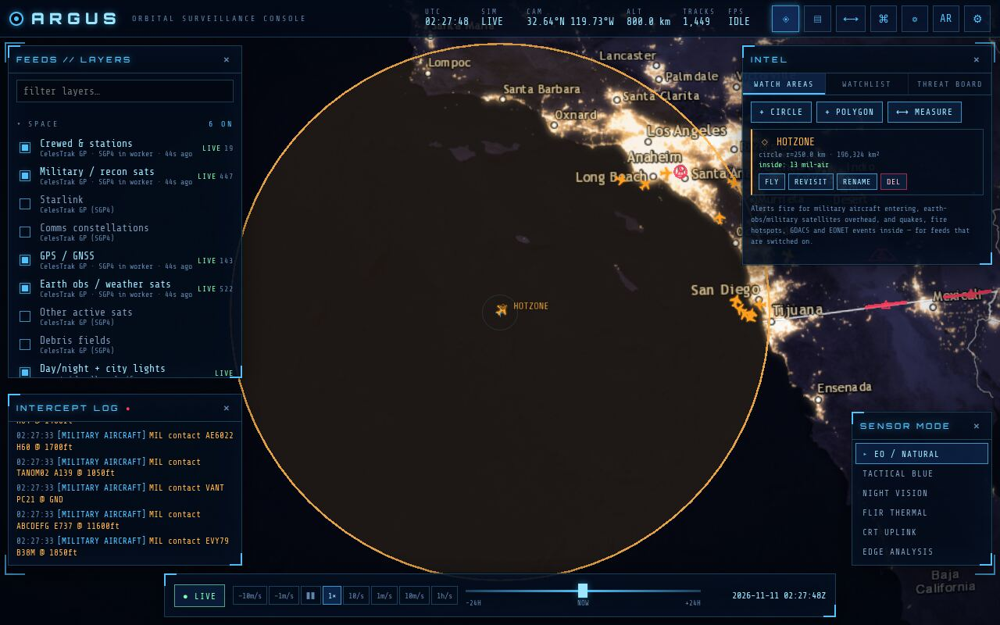
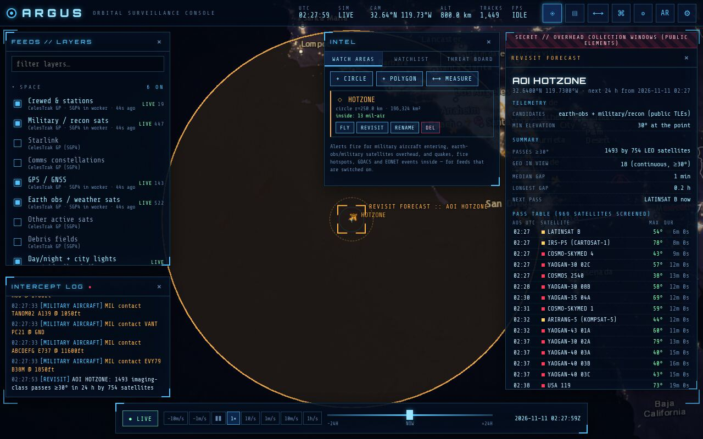
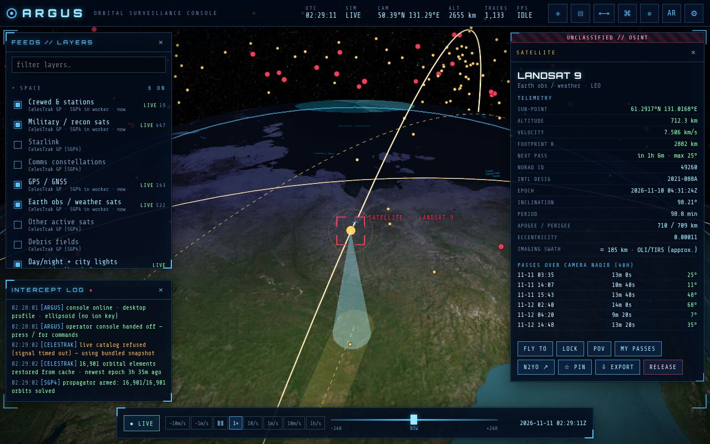
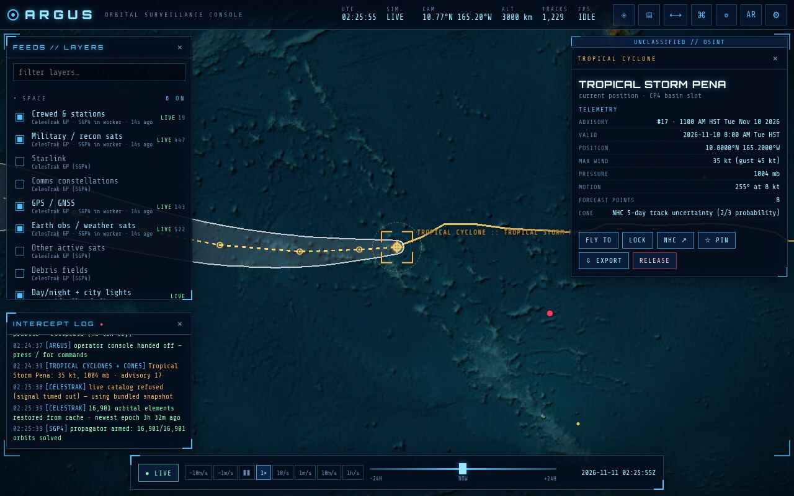
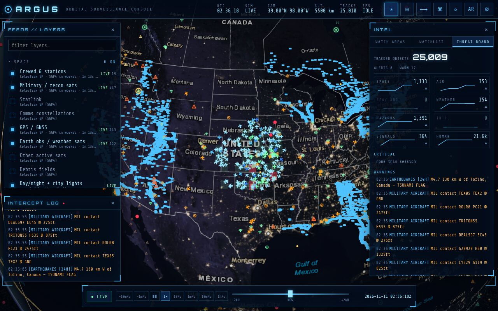
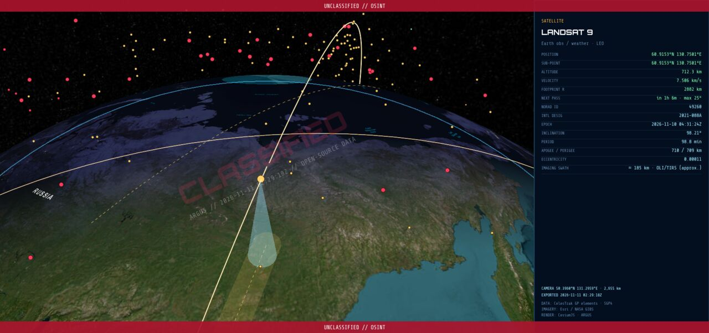
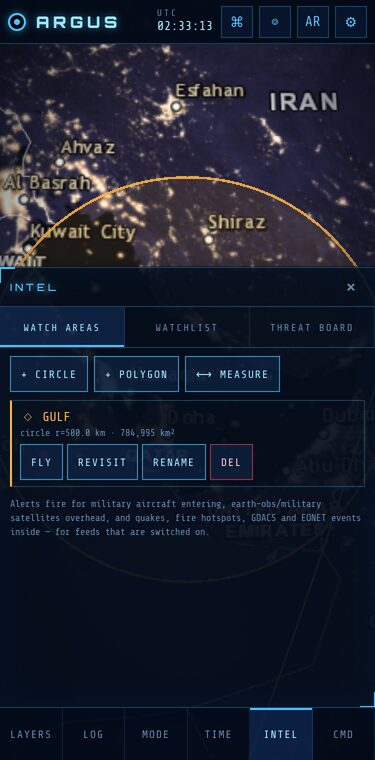

<div align="center">


# A R G U S

**Orbital surveillance console: a real-data "spy satellite" globe in your browser.**

Satellites, flights, military aircraft, ships, trains, weather radar, live IR clouds, tropical cyclones, earthquakes, wildfires, tsunamis, disaster alerts, flight restrictions, GPS interference, undersea cables, military sites, internet outages, radio, 21,000 live traffic cameras, all on one 3D globe. Draw watch areas and get alerted when something enters them.

[](https://distorbed678.github.io/argus/)


<sub>~17,000 real satellites propagated with SGP4 in a Web Worker, shown here at 10 minutes per second</sub>

</div>

---

## ◉ What it does

ARGUS is a Google-Earth-style 3D globe dressed as a sci-fi intelligence console. **Everything on screen is real, public, live data.** There are no mock-ups and no simulated contacts. Every layer shows its source, freshness and status (`LIVE`, `CACHED`, `OFFLINE`, `KEY REQ`, `NEEDS PROXY`).

<table>
<tr>
<td width="50%"></td>
<td width="50%"></td>
</tr>
<tr>
<td><b>Target lock:</b> click any satellite for a classified-style dossier with live altitude, velocity, footprint, orbit ring, ground track and pass predictions.</td>
<td><b>Satellite POV:</b> ride along with the ISS (or any of 17k objects) looking down at the night side's city lights.</td>
</tr>
<tr>
<td></td>
<td></td>
</tr>
<tr>
<td><b>Live air traffic:</b> hundreds of ADS-B targets around the view, colour-coded by altitude, dead-reckoned between polls.</td>
<td><b>Aircraft dossier:</b> callsign, registration, type, altitude, speed, squawk, with alerts for 7500 / 7600 / 7700 emergencies.</td>
</tr>
<tr>
<td></td>
<td></td>
</tr>
<tr>
<td><b>Weather intel:</b> 10-minute geostationary IR clouds (GOES-E/W + Himawari), animated rain radar, disaster alerts.</td>
<td><b>Intercepted feeds:</b> 4,400+ public traffic cameras open in draggable CCTV windows.</td>
</tr>
</table>

### Spy tools

<table>
<tr>
<td width="50%"></td>
<td width="50%"></td>
</tr>
<tr>
<td><b>Watch areas (AOIs):</b> draw a circle or polygon (or <code>aoi add Kyiv 50.45,30.52 60</code>). ARGUS alerts in the log, optionally as browser notifications, when a military aircraft enters, an earth-obs / military satellite passes overhead, or a quake, fire hotspot, GDACS or EONET event lands inside. Alerts are de-duplicated.</td>
<td><b>Revisit forecast:</b> every LEO earth-obs and military satellite pass over a point or AOI in the next 24 h, with times, max elevation, duration and the longest collection gap. The pass maths runs in the SGP4 worker.</td>
</tr>
<tr>
<td></td>
<td></td>
</tr>
<tr>
<td><b>Sensor cones:</b> the selected imaging satellite gets a view cone to the ground and its approximate swath strip along the ground track, sized from typical instrument swaths and labelled approximate.</td>
<td><b>Storms & sky:</b> NHC forecast cones and tracks, live weather balloons with flight paths, and re-entry countdowns for decaying objects.</td>
</tr>
<tr>
<td></td>
<td></td>
</tr>
<tr>
<td><b>Threat board:</b> live counts per category with session sparklines, plus the latest alerts by severity, with AOI hits highlighted.</td>
<td><b>EXPORT:</b> any dossier and the current view become a PNG with a CLASSIFIED watermark, a UTC timestamp and data credits.</td>
</tr>
</table>

Also: **PIN** any target to a persistent watchlist (satellites re-found by NORAD id, aircraft by ICAO hex, with a LOST CONTACT state), **trails** for the selected aircraft or ship, and a great-circle **measure** tool for distance, bearing and area.

### Sensor modes

Real-time GLSL post-processing turns the globe into different "sensors":


### Command line

Press <kbd>/</kbd> anywhere:


```text
track ISS            lock the camera on a target (satellite, callsign, hex, NORAD id…)
aoi add Kyiv 50.45,30.52 60   arm a 60 km watch area (aoi draw · aoi list · aoi del <name>)
revisit Kyiv         earth-obs + military satellite passes over a watch area / lat,lon (next 24 h)
measure              great-circle distance / bearing / area (Esc clears)
pin · unpin · intel  watchlist and the INTEL panel (watch areas, watchlist, threat board)
base history         NASA daily imagery for the timeline's date (try: time -30d)
goto Tokyo           geocode and fly anywhere (or: goto 38.9,-77.03 50)
pov 25544            ride along with a satellite
overhead             everything above your horizon right now
passes ISS           next 72 h of passes over your GPS position
layer fires on       toggle any feed
mode flir            switch sensor mode
time +6h · rate 600 · live
```

### Mobile

Bottom-sheet panels, big touch targets, installable as a full-screen PWA, and an **AR sky view** that overlays the satellites above you on your phone camera using the compass and gyroscope.

<div align="center"> </div>

---

## ◉ Data feeds

<details open>
<summary><b>53 layers in 8 categories</b> (all keyless unless marked)</summary>

| Category | Layers | Source |
|---|---|---|
| **Space** | ~17,000 active satellites in 7 categories (stations, Starlink, comms, GNSS, Earth-obs, **military/recon**, other) + debris fields | CelesTrak GP → SGP4 in a Web Worker |
| | Day/night terminator + city lights, sub-solar/lunar points | computed locally + NASA Black Marble |
| | Aurora oval · Kp index · X-ray flares · NOAA R/S/G scales | NOAA SWPC |
| | Upcoming rocket launches with live countdown | The Space Devs Launch Library 2 |
| | Objects about to re-enter, with a countdown (drag-model **estimate**) | CelesTrak `SPECIAL=DECAYING` |
| **Air** | Live flights (regional zoomed in, global zoomed out) | adsb.lol → adsb.fi → airplanes.live · OpenSky ¹ |
| | Military aircraft worldwide | adsb.lol `/v2/mil` ¹ |
| | US temporary flight restrictions (polygons) | FAA TFR ¹ |
| | GPS-interference **estimate** (share of aircraft with NACp < 8 per 1° cell) | adsb.lol ADS-B quality fields ¹ |
| **Sea / Land** | Ships: Baltic keyless, worldwide with a key | Digitraffic AIS · aisstream.io 🔑 |
| | Live trains | Digitraffic rail (Finland) |
| **Weather** | Animated radar · live geostationary IR clouds · IMERG rain · SST · smoke/aerosol · sampled wind field | RainViewer · NASA GIBS · Open-Meteo |
| | Tropical cyclones: forecast cones, tracks, advisories (Atlantic, E + C Pacific) | NOAA NHC / CPHC MapServer |
| | Weather balloons (radiosondes) with flight paths | SondeHub |
| | Air quality (US AQI, PM2.5, ozone…) · ocean waves and swell, sampled over the view | Open-Meteo air-quality + marine |
| **Hazards** | Earthquakes · natural events · disaster alerts · 24 h fire hotspots · US severe alerts | USGS · NASA EONET · GDACS · NASA FIRMS ¹ · NOAA NWS |
| | Tsunami bulletins · 1,214 Holocene volcanoes | NOAA NTWC + PTWC ¹ · Smithsonian GVP (bundled) |
| **Intel** | Undersea cables + landing stations | TeleGeography (bundled snapshot) |
| | Military sites · nuclear facilities · power plants · airfields · ports · comms towers | OpenStreetMap Overpass (zoom < 600 km) |
| | 3D buildings + world terrain | Cesium ion 🔑 |
| **Signals** | News events by theme · internet outages · 2,500 playable radio stations · live Wikipedia edits | GDELT ¹ · IODA · radio-browser · Wikimedia EventStreams |
| | SatNOGS ground stations + live satellite downlinks in progress | SatNOGS Network (stations bundled, observations ¹) |
| **Human** | 21,600+ traffic cameras · night lights · population density | Caltrans · NYC DOT · 13 state/provincial 511 agencies · Windy 🔑 · NASA GIBS |
| **Base maps** | Satellite · tactical dark · VIIRS true colour · OSM · **history** (MODIS daily for the timeline date) | Esri · NASA GIBS · OpenStreetMap |

¹ These APIs block browser CORS, so they go through a relay (see below).  🔑 Optional free key.

Click **empty ground** anywhere for a *ground intel* readout: place name, live weather, wind, visibility, elevation and local time, plus a **REVISIT** forecast for that spot.

**Honest limits.** Re-entry countdowns and GPS interference are labelled estimates. JTWC publishes only text/KMZ products, so West Pacific and Indian Ocean storms come from GDACS instead of cones. The public ADS-B trace files are bot-protected, so trails are built in the browser from each poll.

</details>

---

## ◉ Run it

```bash
git clone https://github.com/Distorbed678/argus.git
cd argus
npm install
npm run dev        # http://localhost:5173 (includes the CORS relay)
```

| Script | |
|---|---|
| `npm run dev` | dev server with the built-in relay |
| `npm run build` | type-check + production build → `dist/` |
| `npm run preview` | serve `dist/` with the relay |
| `npm run data` | refresh bundled snapshots (satellite catalog, cameras, cables, volcanoes, SatNOGS stations, country centroids). Run one with `node scripts/fetch-static-data.mjs cameras` |
| `npm run typecheck` · `npm test` | strict TypeScript · Vitest unit tests (parsers, orbit/astro maths, AOI geometry, estimates) |
| `npm run test:e2e` | Playwright smoke test on the production preview at desktop and 375 px (run `npm run build` first) |

### CORS relay

GitHub Pages only serves static files, so on the [live demo](https://distorbed678.github.io/argus/) the relayed layers (flights, military aircraft, GPS interference, fires, GDELT, US TFRs, tsunami bulletins, SatNOGS observations) show **`NEEDS PROXY`**. Everything else works out of the box. To light them up:

1. Deploy [`proxy/cloudflare-worker.js`](proxy/cloudflare-worker.js) for free: `npx wrangler deploy proxy/cloudflare-worker.js --name argus-proxy --compatibility-date 2025-01-01`
2. Open ⚙ **Settings → Proxy URL** and paste `https://argus-proxy.<you>.workers.dev/?url=`

The relay only forwards to an allowlist of hosts and edge-caches responses for 10 s, so all viewers share one upstream fetch.

### Optional keys (⚙ Settings, stored only in your browser)

| Key | Unlocks | Get one |
|---|---|---|
| Cesium ion | World terrain + OSM 3D buildings | [cesium.com/ion](https://cesium.com/ion/) |
| aisstream.io | Worldwide live ships in view | [aisstream.io](https://aisstream.io/) |
| Windy Webcams | Tens of thousands of webcams worldwide | [api.windy.com](https://api.windy.com/webcams) |

---

## ◉ Under the hood

```text
src/
├─ core/        viewer, clock (time scrub), target lock/POV, store, bus, observer, astro
├─ data/        fetcher: memory + IndexedDB cache, CORS fallback, backoff, pause-when-hidden
├─ layers/      one module per feed, lazy-loaded on first toggle
│  ├─ satellites/   catalog → Web Worker SGP4 → single PointPrimitiveCollection
│  ├─ weather/ hazards/ sky/ intel/ signals/
│  └─ pointLayer.ts   generic poll → diff → billboards → pick → dossier
├─ spy/         watch areas + alerts, watchlist, revisit, trails, measure, PNG export
├─ fx/          GLSL post-process sensor modes
├─ ui/          boot, HUD, layer panel, dossier, INTEL panel + threat board, command line, timeline, feeds
└─ ar/          camera + compass sky view
tests/
├─ unit/        Vitest: pure modules only (no WebGL)
└─ e2e/         Playwright smoke test, third-party network stubbed
```

- **Fast:** the whole catalog is propagated off the main thread about once a second. Revisit forecasts and AOI overflight checks run in the same worker. Rendering uses primitive collections (no per-object Entities), `requestRenderMode` keeps the GPU idle when nothing moves, and every layer is a lazy chunk. It holds ~58 FPS with all 40+ layers and ~54,000 objects on screen.
- **Polite:** CelesTrak elements are cached 2 h (their fair-use limit), with a bundled snapshot fallback that the CI refreshes daily. Polling backs off exponentially on errors and stops while the tab is hidden.
- **Honest:** "military/recon" satellites are only objects with publicly released elements. Military aircraft are only those broadcasting ADS-B. Each dossier says what is and isn't known.
- **Accessible:** *Reduce effects* turns off glyph rain, scanlines and glitch effects. It defaults to on when `prefers-reduced-motion` is set.

### Deployment

[`.github/workflows/pages.yml`](.github/workflows/pages.yml) runs typecheck, unit tests and the Playwright smoke test, then builds and deploys to GitHub Pages on every push to `main` (pull requests run the tests only). It also rebuilds **daily**, which refreshes the bundled satellite, camera, cable, volcano and SatNOGS snapshots.

---

<div align="center">

**ARGUS**: named after Argus Panoptes, the hundred-eyed giant who never slept.

<sub>Data © their respective providers: CelesTrak, NASA, NOAA (NHC, NWS, SWPC, NTWC, PTWC), USGS, GDACS, FAA, Smithsonian GVP, SondeHub, SatNOGS, OpenStreetMap contributors, TeleGeography, adsb.lol, OpenSky Network, Digitraffic, RainViewer, Open-Meteo / CAMS, Esri, Caltrans, NYC DOT, the 511 road agencies of Ontario, Alaska, Wisconsin, Georgia, Arizona, Idaho, Utah, Nevada, Louisiana, Pennsylvania, New England, Connecticut and Florida, Wikimedia, radio-browser and others. Built with CesiumJS.</sub>

</div>
